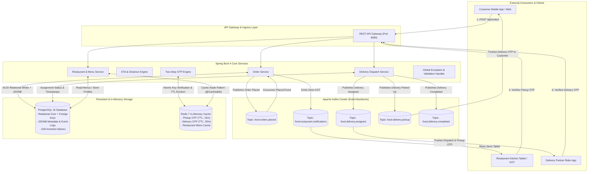
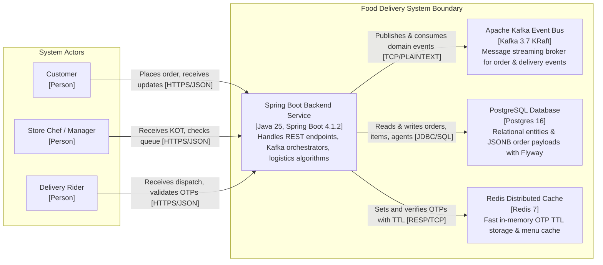
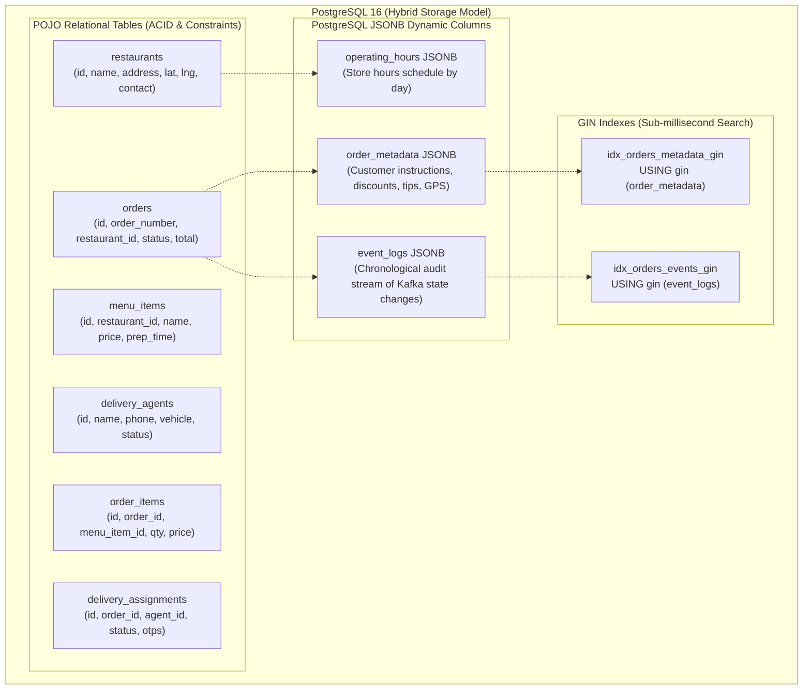

# 01 - BiteStream System Architecture & Component Blueprint

## 1. High-Level Architecture Diagram

---

## 2. C4 Container Diagram

---

## 3. Detailed Component Architecture

### 3.1 Order Management Component (`com.fooddelivery.service.OrderService`)
* **Responsibilities**:
  - Validates menu items against the designated store.
  - Computes active queue depth of orders ahead at the store.
  - Queries `EtaCalculationService` for preparation and transit ETA.
  - Constructs the relational `Order` entity, embeds `OrderMetadata` and initial `EventLogEntry` in PostgreSQL `jsonb` columns.
  - Emits `OrderPlacedEvent` to Kafka topic `food.orders.placed`.

### 3.2 Logistics & ETA Engine (`com.fooddelivery.service.EtaCalculationService`)
* **Responsibilities**:
  - Distance modeling: Computes transit time for 2.0 km, 3.0 km, 4.0 km, 5.0 km at 20 km/h baseline urban speed with 4 minutes buffer.
  - Queue penalty modeling: Ingests queue position count ($Q$) and adds 3 minutes delay per order ahead in the restaurant kitchen:
    $$\text{ETA}_{\text{total}} = \text{PrepTime}_{\text{item}} + (Q \times 3\text{ min}) + \left(\frac{D}{20} \times 60 + 4\right)$$

### 3.3 Two-Step OTP Security Service (`com.fooddelivery.service.OtpService`)
* **Responsibilities**:
  - Generates cryptographically secure 6-digit numerical codes using `SecureRandom`.
  - Writes OTPs to Redis with distinct TTL windows:
    - `food_delivery:otp:pickup:{orderId}`: **15 minutes TTL**
    - `food_delivery:otp:delivery:{orderId}`: **30 minutes TTL**
  - Executes atomic comparison and key deletion upon successful verification (`GETDEL` semantics).

### 3.4 Delivery Dispatch Service (`com.fooddelivery.service.DeliveryAgentService`)
* **Responsibilities**:
  - Maintains fleet status (`AVAILABLE`, `ASSIGNED`, `BUSY`, `OFFLINE`) for the 20 delivery agents.
  - Calculates Euclidean/Haversine distance between restaurant coordinates and agent coordinates.
  - Atomically assigns the closest available partner to the order.

---

## 4. Cache Evaluation Matrix: Redis vs. EHCache

| Dimension | Redis Cache (Selected ✅) | EHCache (Rejected ❌) | Architectural Impact |
| :--- | :--- | :--- | :--- |
| **Topology** | Distributed external in-memory data store | In-process JVM heap / local memory | Essential for multi-instance microservices. When multiple pods consume Kafka events, Redis ensures global cache coherence without cluster lag. |
| **TTL Eviction** | Native sub-millisecond per-key TTL (`SETEX`) | Cache-level or manual entry expiration | Pickup and Delivery OTPs naturally expire after 15/30 minutes without requiring custom background sweeper threads. |
| **Concurrency & Atomic Ops** | Single-threaded atomic primitives (`GETDEL`, `SET NX`) | Thread locking / JVM synchronization | Guarantees atomic verification of OTPs and prevents double-assignment of delivery agents. |
| **Geospatial Queries** | Built-in Geospatial commands (`GEOADD`, `GEODIST`) | Not natively supported | Enables lightning-fast radius searches for nearest available agents around restaurant coordinates. |
| **Resilience & Restarts** | Independent lifecycle, AOF/RDB persistence | Cleared on application JVM restart | Application rolling restarts do not wipe active OTPs or unexpired menu caches. |

---

## 5. Hybrid Data Architecture: POJO Relational + JSONB

