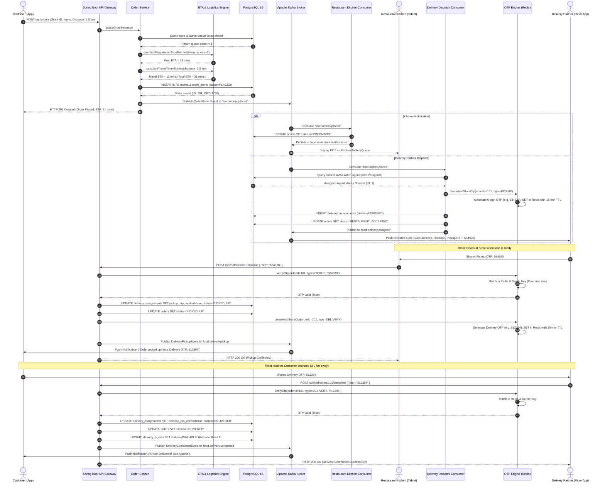
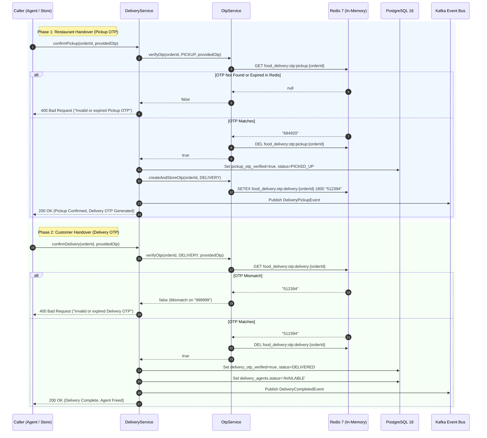
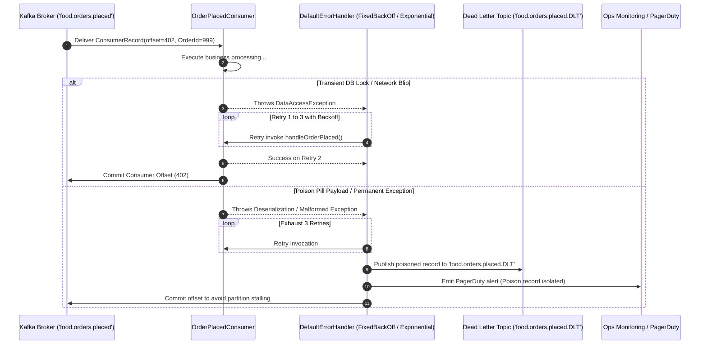

# 02 - Dynamic Sequence Diagrams

## 1. End-to-End Order & Delivery Lifecycle Flow

This sequence diagram depicts the complete journey of a customer order from placement through distance calculation, Kafka event emission, restaurant notification, agent dispatch, and two-step OTP verification.

---

## 2. Two-Step OTP Verification Sequence Diagram

---

## 3. Kafka Consumer Error & Retry Sequence Diagram

