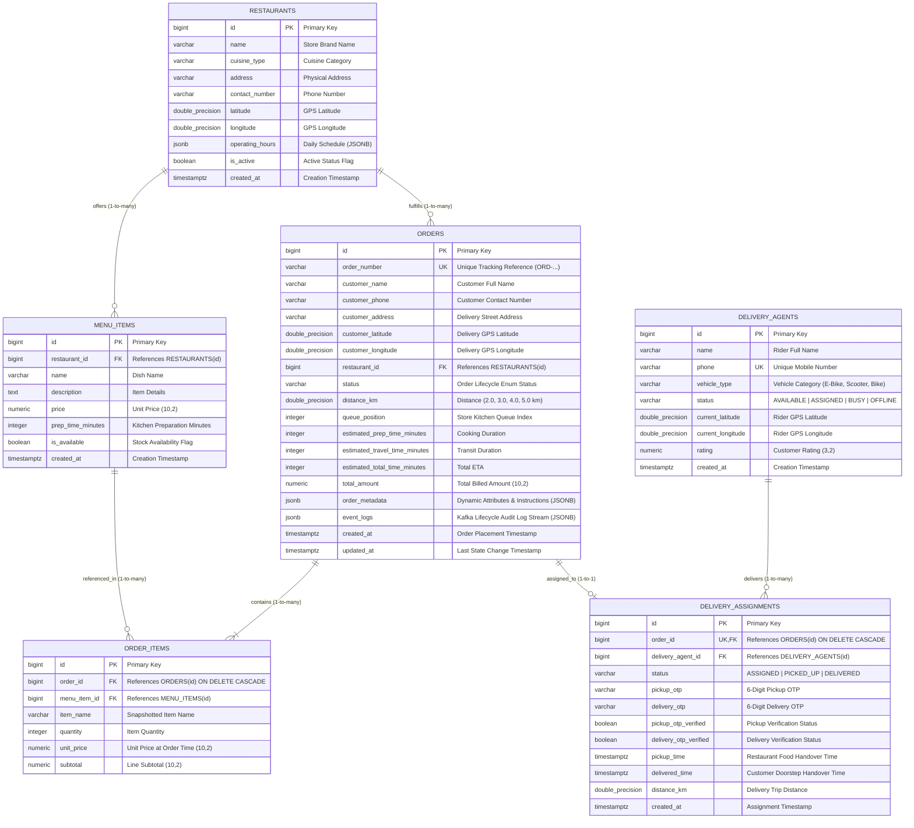

# 03 - Data Models & Entity-Relationship (ER) Diagram

## 1. Complete Entity-Relationship (ER) Diagram



---

## 2. Table Specifications & Indexing Strategy

### 2.1 Indexing Matrix

| Table | Index Name | Type | Column(s) | Architectural Purpose |
| :--- | :--- | :--- | :--- | :--- |
| `restaurants` | `idx_restaurants_active` | B-tree | `(is_active)` | Quick filtering of operational restaurants |
| `menu_items` | `idx_menu_items_restaurant` | B-tree | `(restaurant_id, is_available)` | Index-only scans when fetching active store menus |
| `delivery_agents`| `idx_agents_status` | B-tree | `(status)` | Fast lookup of `AVAILABLE` agents during dispatch |
| `orders` | `idx_orders_restaurant_status` | B-tree | `(restaurant_id, status)` | Fast calculation of store queue depth ahead |
| `orders` | `idx_orders_status` | B-tree | `(status)` | Administrative queries on active orders |
| `orders` | `idx_orders_metadata_gin` | **GIN** | `order_metadata` | Sub-millisecond JSONB search by instructions or tags |
| `orders` | `idx_orders_events_gin` | **GIN** | `event_logs` | Sub-millisecond JSONB query over event history |
| `order_items` | `idx_order_items_order` | B-tree | `(order_id)` | Fast joining of line items to order header |
| `delivery_assignments`| `idx_delivery_assignments_order` | B-tree | `(order_id)` | Instant lookup of order assignment record |
| `delivery_assignments`| `idx_delivery_assignments_agent` | B-tree | `(delivery_agent_id)` | Audit & tracking of agent assignments |

---

## 3. JSONB Schema Specifications

### 3.1 `orders.order_metadata` Schema
Stores non-relational, flexible metadata without requiring DDL alterations:
```json
{
  "$schema": "http://json-schema.org/draft-07/schema#",
  "title": "OrderMetadata",
  "type": "object",
  "properties": {
    "specialInstructions": {
      "type": "string",
      "description": "Customer notes for chef/rider (e.g., 'Extra spicy, do not ring bell')"
    },
    "paymentMethod": {
      "type": "string",
      "enum": ["ONLINE_UPI", "CREDIT_CARD", "DEBIT_CARD", "NET_BANKING", "CASH_ON_DELIVERY"]
    },
    "tipAmount": {
      "type": "number",
      "description": "Optional rider tip"
    },
    "discountAmount": {
      "type": "number",
      "description": "Promotional discounts applied"
    },
    "priority": {
      "type": "string",
      "enum": ["STANDARD", "HIGH_DISTANCE", "VIP"]
    },
    "additionalAttributes": {
      "type": "object",
      "description": "Arbitrary key-value metadata (e.g. queue_depth, promo_code)"
    }
  }
}
```

### 3.2 `orders.event_logs` Schema
Stores an immutable audit trail of Kafka event lifecycle transitions:
```json
[
  {
    "eventType": "ORDER_PLACED",
    "topic": "food.orders.placed",
    "timestamp": "2026-11-14T08:15:00.120Z",
    "description": "Order created with Queue position #1, Distance 3.0 km",
    "triggeredBy": "API_GATEWAY"
  },
  {
    "eventType": "DELIVERY_ASSIGNED",
    "topic": "food.delivery.assigned",
    "timestamp": "2026-11-14T08:15:01.450Z",
    "description": "Assigned partner Aarav Sharma (Electric Scooter). Pickup OTP generated.",
    "triggeredBy": "DISPATCHER"
  },
  {
    "eventType": "KITCHEN_PREPARING",
    "topic": "food.restaurant.notifications",
    "timestamp": "2026-11-14T08:15:02.100Z",
    "description": "Store Spice Symphony Gourmet started cooking order. Position in queue: #1",
    "triggeredBy": "RESTAURANT_KOT"
  },
  {
    "eventType": "DELIVERY_PICKED_UP",
    "topic": "food.delivery.pickup",
    "timestamp": "2026-11-14T08:20:00.000Z",
    "description": "Agent Aarav Sharma picked up order from restaurant. Customer Delivery OTP generated.",
    "triggeredBy": "RESTAURANT_AGENT_APP"
  },
  {
    "eventType": "ORDER_DELIVERED",
    "topic": "food.delivery.completed",
    "timestamp": "2026-11-14T08:33:00.000Z",
    "description": "Order delivered successfully to customer by Aarav Sharma",
    "triggeredBy": "CUSTOMER_AGENT_APP"
  }
]
```

### 3.3 `restaurants.operating_hours` Schema
```json
{
  "monday": { "open": "11:00", "close": "23:00" },
  "tuesday": { "open": "11:00", "close": "23:00" },
  "wednesday": { "open": "11:00", "close": "23:00" },
  "thursday": { "open": "11:00", "close": "23:00" },
  "friday": { "open": "11:00", "close": "23:59" },
  "saturday": { "open": "11:00", "close": "23:59" },
  "sunday": { "open": "11:00", "close": "23:00" }
}
```

---

## 4. Pre-Seeded Catalog & Master Fleet

| Entity | Quantity | Key Details |
| :--- | :---: | :--- |
| **Restaurants (Stores)** | **5** | 1. *Spice Symphony Gourmet* (North Indian)<br>2. *Bella Napoli Woodfire Pizzeria* (Italian)<br>3. *Dragon Wok Pan-Asian* (Pan-Asian)<br>4. *Green Delight Organic & Salads* (Healthy/Vegan)<br>5. *Burger Crave Smokehouse* (Burgers/BBQ) |
| **Menu Items** | **50** | **10 items per store**, pricing ranging from \$3.50 (Garlic Naan) to \$18.00 (Tandoori Platter), preparation durations between 4 and 22 minutes |
| **Delivery Agents** | **20** | 20 dedicated riders with verified vehicles (*Electric Scooters, Ather 450X, Ola S1, Honda Activa, Yamaha FZ, TVS Apache*), active ratings 4.75 - 4.95, and distributed coordinates |
