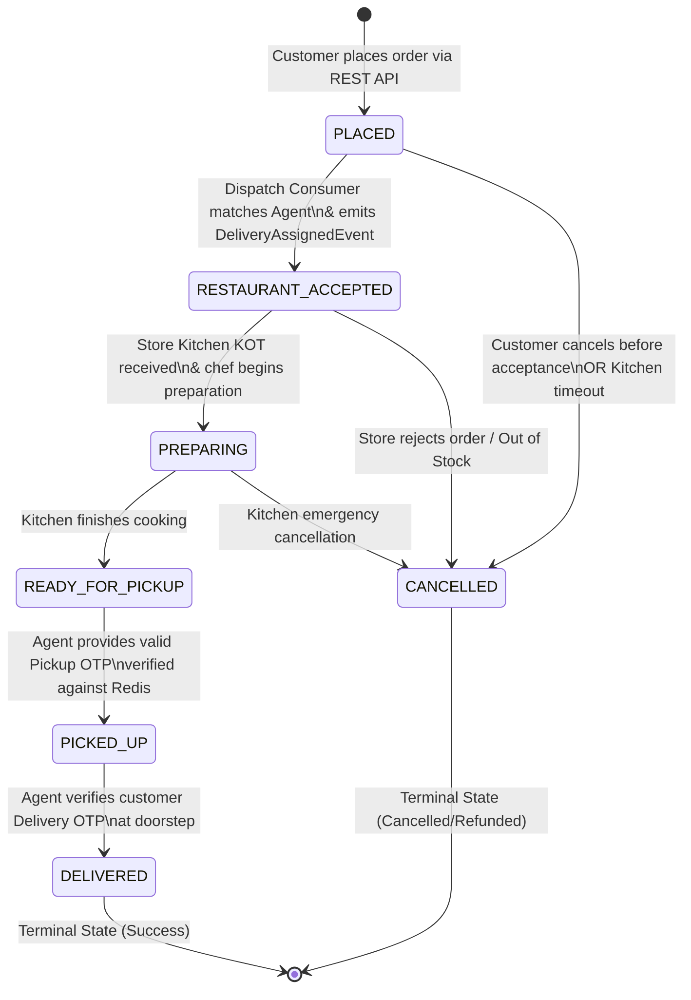
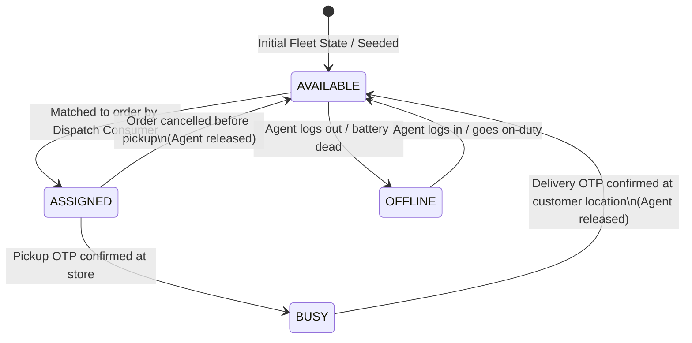

# 04 - State Machine & Concurrency Specifications

## 1. Order Lifecycle State Machine Diagram



---

## 2. Delivery Agent State Machine Diagram



---

## 3. Order State Transition Matrix

The table below outlines the transition rules enforced across the system:

| Source State | Target State | Triggering Event / Action | Auth Role | Side Effects & Actions |
| :--- | :--- | :--- | :--- | :--- |
| `[*] (None)` | `PLACED` | `POST /api/orders` | Customer | Order & items persisted; distance ETA calculated; `OrderPlacedEvent` emitted. |
| `PLACED` | `RESTAURANT_ACCEPTED` | Kafka `food.orders.placed` | System / Dispatcher | Nearest agent assigned; 6-digit **Pickup OTP** generated in Redis (TTL: 15m); `DeliveryAssignedEvent` emitted. |
| `RESTAURANT_ACCEPTED` | `PREPARING` | Kafka `food.restaurant.notifications` | Store Kitchen | Cooking started; `event_logs` appended with kitchen queue timestamp. |
| `PREPARING` | `READY_FOR_PICKUP` | Kitchen finishes cooking | Store Kitchen | Store marks packet ready on terminal. |
| `READY_FOR_PICKUP` | `PICKED_UP` | `POST /api/deliveries/{id}/pickup` | Store / Agent | Validates **Pickup OTP** from Redis; deletes Pickup key; generates **Delivery OTP** in Redis (TTL: 30m); emits `DeliveryPickupEvent`. |
| `PICKED_UP` | `DELIVERED` | `POST /api/deliveries/{id}/complete`| Customer / Agent | Validates **Delivery OTP** from Redis; deletes Delivery key; frees agent back to `AVAILABLE`; emits `DeliveryCompletedEvent`. |
| `PLACED` / `RESTAURANT_ACCEPTED` | `CANCELLED` | `POST /api/orders/{id}/cancel` | Customer / Store | Releases assigned agent back to `AVAILABLE`; voids active Redis OTP; triggers refund. |

### Forbidden Transitions (Illegal State Mutations)
* ❌ `DELIVERED` $\to$ Any State (Terminal state cannot be modified).
* ❌ `CANCELLED` $\to$ Any State (Terminal state cannot be resurrected).
* ❌ `PLACED` $\to$ `PICKED_UP` (Cannot skip restaurant acceptance or cooking).
* ❌ `PREPARING` $\to$ `DELIVERED` (Cannot skip food pickup verification).
* ❌ `PICKED_UP` $\to$ `CANCELLED` (Once food is on the road, standard cancellation is prohibited).

---

## 4. Concurrency & Race Condition Defense

### 4.1 Double-Assignment Prevention
When multiple Kafka worker threads consume orders simultaneously, agent assignment must be strictly atomic:

```sql
-- Atomic SQL Selection & State Transition
UPDATE delivery_agents 
SET status = 'ASSIGNED' 
WHERE id = (
    SELECT id FROM delivery_agents 
    WHERE status = 'AVAILABLE' 
    ORDER BY (
        (current_latitude - :storeLat)^2 + (current_longitude - :storeLng)^2
    ) ASC 
    LIMIT 1 
    FOR UPDATE SKIP LOCKED
)
RETURNING *;
```

### 4.2 Distributed Redis Agent Locking
To avoid cross-pod assignment collision:
* Key: `lock:agent:{agentId}`
* Value: `{orderId}`
* Command: `SET lock:agent:{agentId} {orderId} NX PX 10000` (10 seconds expiry)
* Release: Validated Lua script to delete only if the value matches `{orderId}`.
