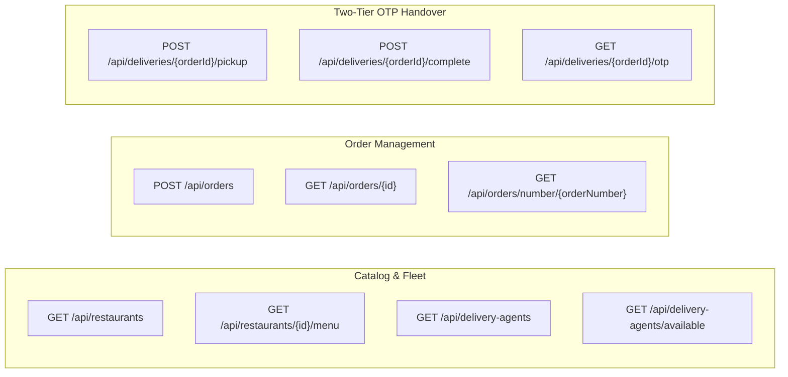
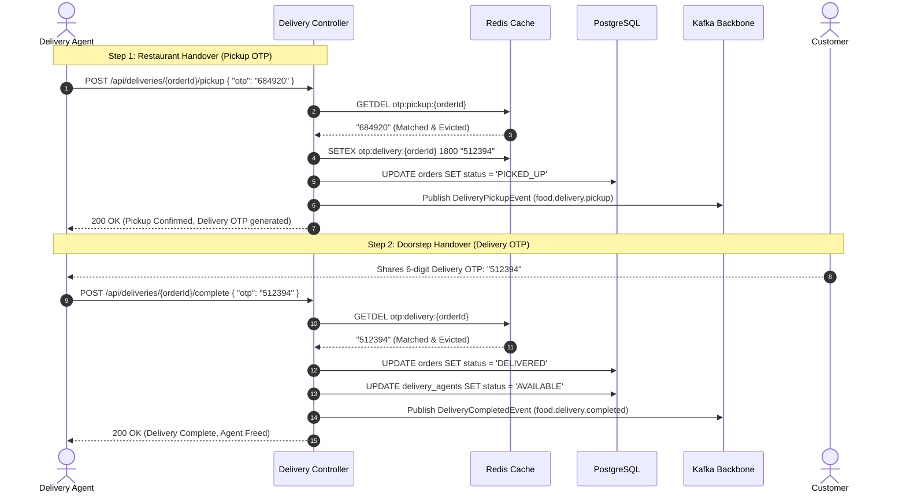

# 05 - BiteStream RESTful API Interface Specification

---

## 1. Document Overview & Protocol Standards

This specification details all HTTP RESTful endpoints provided by the **BiteStream** event-driven food delivery backend platform. It specifies exact request and response schemas, field-level validation rules, HTTP status codes, error payloads, and full lifecycle execution examples.

### 1.1 Base URLs & Environments
| Environment | Base URL | Description |
|---|---|---|
| **Local Standalone** | `http://localhost:8080/api` | Direct Spring Boot app on host |
| **Docker Compose** | `http://localhost:8080/api` | Containerized `bitestream-app` service |
| **Kubernetes (Ingress)** | `https://bitestream.internal/api` | Cluster ingress with TLS termination |

### 1.2 Global Request & Response Headers
| Header | Direction | Type | Required | Description |
|---|---|---|---|---|
| `Content-Type` | Request / Response | `string` | **Yes** (for POST) | Always `application/json` |
| `Accept` | Request | `string` | No | Recommended `application/json` |
| `Idempotency-Key` | Request | `string (UUID)` | Optional | Recommended for deduplication on `POST /api/orders` |
| `X-Correlation-ID` | Request / Response | `string (UUID)` | Recommended | Distributed trace correlation identifier propagated through Kafka headers |

### 1.3 Standard HTTP Status Code Conventions
| HTTP Status | Meaning | Typical Usage in BiteStream |
|---|---|---|
| `200 OK` | Success | Successful inquiry, pickup verification, or delivery completion |
| `201 Created` | Created | Successfully placed order and published Kafka event |
| `400 Bad Request` | Client Error | Input validation failure (e.g. invalid phone, distance out of range) or invalid/expired OTP |
| `404 Not Found` | Not Found | Order, Restaurant, Menu Item, or Delivery Agent does not exist |
| `409 Conflict` | State Conflict | Illegal state transition (e.g., confirming pickup on an already delivered order) |
| `500 Internal Error`| Server Error | Unexpected database, cache, or broker connectivity failure |

---

## 2. API Endpoints Catalog



---

## 3. Order Management Endpoints

### 3.1 Place Food Delivery Order

* **Endpoint**: `POST /api/orders`
* **Description**: Validates customer information, restaurant existence, and menu items. Dynamically calculates prep queue penalty and distance-based travel time (for 2.0, 3.0, 4.0, 5.0 km, etc.). Persists order with relational items and JSONB audit metadata, then publishes `OrderPlacedEvent` to Kafka topic `food.orders.placed`.

#### Request Headers
```http
POST /api/orders HTTP/1.1
Host: localhost:8080
Content-Type: application/json
Accept: application/json
Idempotency-Key: a4c1d2e3-5f6a-4b7c-8d9e-1f2a3b4c5d6e
```

#### Request Parameters & Body Schema
| Field | Type | Required | Constraints | Description |
|---|---|---|---|---|
| `customerName` | `string` | **Yes** | `@NotBlank` | Full name of the customer |
| `customerPhone` | `string` | **Yes** | `@NotBlank` | Phone number for SMS and delivery tracking |
| `customerAddress` | `string` | **Yes** | `@NotBlank` | Doorstep delivery address |
| `customerLatitude` | `number (double)` | No | Optional | GPS latitude of delivery location |
| `customerLongitude`| `number (double)` | No | Optional | GPS longitude of delivery location |
| `restaurantId` | `integer (int64)`| **Yes** | `@NotNull` | Target restaurant ID (1 to 5) |
| `distanceKm` | `number (double)` | **Yes** | `@NotNull`, Min `0.5`, Max `25.0` | Distance between store and customer (e.g., 2.0, 3.0, 4.0, 5.0 km) |
| `items` | `array` | **Yes** | `@NotEmpty` | List of items to order (min 1 item) |
| `items[].menuItemId`| `integer (int64)`| **Yes** | `@NotNull` | ID of the menu item from restaurant catalog |
| `items[].quantity` | `integer (int32)`| **Yes** | `@Min(1)` | Quantity to prepare |
| `specialInstructions`| `string` | No | Optional | Dietary or delivery note stored in JSONB metadata |
| `paymentMethod` | `string` | No | Optional | Payment type (`ONLINE_UPI`, `CARD`, `CASH_ON_DELIVERY`) |

#### Example Request Payload
```json
{
  "customerName": "Rahul Verma",
  "customerPhone": "+91-9876540001",
  "customerAddress": "Apartment 402, Lotus Towers, Sector 18, New Delhi",
  "customerLatitude": 28.6250,
  "customerLongitude": 77.2150,
  "restaurantId": 1,
  "distanceKm": 3.0,
  "specialInstructions": "Extra spicy, please do not ring the doorbell",
  "paymentMethod": "ONLINE_UPI",
  "items": [
    {
      "menuItemId": 1,
      "quantity": 2
    },
    {
      "menuItemId": 5,
      "quantity": 3
    }
  ]
}
```

#### Success Response (`201 Created`)
```json
{
  "orderId": 101,
  "orderNumber": "ORD-1763105000000-482",
  "status": "PLACED",
  "restaurantId": 1,
  "restaurantName": "Spice Symphony Gourmet",
  "customerName": "Rahul Verma",
  "customerPhone": "+91-9876540001",
  "customerAddress": "Apartment 402, Lotus Towers, Sector 18, New Delhi",
  "distanceKm": 3.0,
  "queuePosition": 1,
  "estimatedPrepTimeMinutes": 18,
  "estimatedTravelTimeMinutes": 13,
  "estimatedTotalDeliveryTimeMinutes": 31,
  "totalAmount": 40.48,
  "items": [
    {
      "id": 1,
      "menuItemId": 1,
      "itemName": "Butter Chicken Royale",
      "quantity": 2,
      "unitPrice": 14.99,
      "subtotal": 29.98
    },
    {
      "id": 2,
      "menuItemId": 5,
      "itemName": "Garlic Butter Naan",
      "quantity": 3,
      "unitPrice": 3.50,
      "subtotal": 10.50
    }
  ],
  "metadata": {
    "specialInstructions": "Extra spicy, please do not ring the doorbell",
    "paymentMethod": "ONLINE_UPI",
    "deliveryPriority": "STANDARD",
    "clientIp": "127.0.0.1",
    "tags": ["NORTH_INDIAN", "FAST_TRACK"]
  },
  "lifecycleEvents": [
    {
      "eventType": "ORDER_PLACED",
      "topic": "food.orders.placed",
      "timestamp": "2026-11-14T08:15:00.120Z",
      "description": "Order created with Queue position #1, Distance 3.0 km",
      "triggeredBy": "API_GATEWAY"
    }
  ],
  "createdAt": "2026-11-14T08:15:00.100Z"
}
```

#### Error Response: Validation Failure (`400 Bad Request`)
```json
{
  "timestamp": "2026-11-14T08:15:00.250Z",
  "status": 400,
  "error": "Validation Error",
  "details": {
    "customerPhone": "Customer phone is required",
    "distanceKm": "Minimum distance is 0.5 km",
    "items": "At least one menu item must be selected"
  }
}
```

#### Error Response: Restaurant Not Found (`400 Bad Request`)
```json
{
  "timestamp": "2026-11-14T08:15:00.310Z",
  "status": 400,
  "message": "Restaurant not found with id: 99"
}
```

#### cURL Command
```bash
curl -X POST http://localhost:8080/api/orders \
  -H "Content-Type: application/json" \
  -d '{
    "customerName": "Rahul Verma",
    "customerPhone": "+91-9876540001",
    "customerAddress": "Apartment 402, Lotus Towers, Sector 18, New Delhi",
    "customerLatitude": 28.6250,
    "customerLongitude": 77.2150,
    "restaurantId": 1,
    "distanceKm": 3.0,
    "specialInstructions": "Extra spicy, please do not ring the doorbell",
    "paymentMethod": "ONLINE_UPI",
    "items": [
      { "menuItemId": 1, "quantity": 2 },
      { "menuItemId": 5, "quantity": 3 }
    ]
  }'
```

---

### 3.2 Get Order by Database ID

* **Endpoint**: `GET /api/orders/{id}`
* **Description**: Fetches the complete order representation including item breakdown, current status, JSONB metadata, and the full event lifecycle audit log.

#### Path Parameters
| Parameter | Type | Required | Description |
|---|---|---|---|
| `id` | `integer (int64)` | **Yes** | Internal primary key of the order (e.g. `101`) |

#### Success Response (`200 OK`)
```json
{
  "orderId": 101,
  "orderNumber": "ORD-1763105000000-482",
  "status": "ASSIGNED",
  "restaurantId": 1,
  "restaurantName": "Spice Symphony Gourmet",
  "customerName": "Rahul Verma",
  "customerPhone": "+91-9876540001",
  "customerAddress": "Apartment 402, Lotus Towers, Sector 18, New Delhi",
  "distanceKm": 3.0,
  "queuePosition": 1,
  "estimatedPrepTimeMinutes": 18,
  "estimatedTravelTimeMinutes": 13,
  "estimatedTotalDeliveryTimeMinutes": 31,
  "totalAmount": 40.48,
  "items": [
    {
      "id": 1,
      "menuItemId": 1,
      "itemName": "Butter Chicken Royale",
      "quantity": 2,
      "unitPrice": 14.99,
      "subtotal": 29.98
    },
    {
      "id": 2,
      "menuItemId": 5,
      "itemName": "Garlic Butter Naan",
      "quantity": 3,
      "unitPrice": 3.50,
      "subtotal": 10.50
    }
  ],
  "metadata": {
    "specialInstructions": "Extra spicy, please do not ring the doorbell",
    "paymentMethod": "ONLINE_UPI",
    "assignedAgentId": 1,
    "assignedAgentName": "Aarav Sharma"
  },
  "lifecycleEvents": [
    {
      "eventType": "ORDER_PLACED",
      "topic": "food.orders.placed",
      "timestamp": "2026-11-14T08:15:00.120Z",
      "description": "Order created with Queue position #1, Distance 3.0 km",
      "triggeredBy": "API_GATEWAY"
    },
    {
      "eventType": "DELIVERY_ASSIGNED",
      "topic": "food.delivery.assigned",
      "timestamp": "2026-11-14T08:15:01.450Z",
      "description": "Agent Aarav Sharma assigned. Pickup OTP generated.",
      "triggeredBy": "DELIVERY_DISPATCHER"
    }
  ],
  "createdAt": "2026-11-14T08:15:00.100Z"
}
```

#### Error Response: Order Not Found (`400 Bad Request`)
```json
{
  "timestamp": "2026-11-14T08:16:00.100Z",
  "status": 400,
  "message": "Order not found with id: 999"
}
```

#### cURL Command
```bash
curl -X GET http://localhost:8080/api/orders/101
```

---

### 3.3 Get Order by Business Order Number

* **Endpoint**: `GET /api/orders/number/{orderNumber}`
* **Description**: Queries order by human-readable reference number (e.g., `ORD-1763105000000-482`) used on customer receipts and delivery bags.

#### Path Parameters
| Parameter | Type | Required | Description |
|---|---|---|---|
| `orderNumber` | `string` | **Yes** | Unique business order number |

#### Success Response (`200 OK`)
Same schema as `OrderResponse` (see Section 3.2).

#### Error Response (`400 Bad Request`)
```json
{
  "timestamp": "2026-11-14T08:16:10.550Z",
  "status": 400,
  "message": "Order not found with order number: ORD-INVALID-999"
}
```

#### cURL Command
```bash
curl -X GET http://localhost:8080/api/orders/number/ORD-1763105000000-482
```

---

## 4. Two-Tier OTP & Delivery Handover Endpoints



---

### 4.1 Confirm Restaurant Pickup (`Pickup OTP`)

* **Endpoint**: `POST /api/deliveries/{orderId}/pickup`
* **Description**: The delivery agent verifies the 6-digit **Pickup OTP** at the restaurant counter. Validates against Redis key `otp:pickup:{orderId}`. On success:
  1. Transitions Order status to `PICKED_UP`.
  2. Evicts the used Pickup OTP from Redis (`GETDEL`).
  3. Generates a secure 6-digit **Delivery OTP** and stores it in Redis under `otp:delivery:{orderId}` with a **30-minute TTL**.
  4. Publishes `DeliveryPickupEvent` to Kafka topic `food.delivery.pickup`.
  5. Appends an audit event to the order's JSONB lifecycle history.

#### Request Parameters & Body Schema
| Field | Type | Required | Constraints | Description |
|---|---|---|---|---|
| `otp` | `string` | **Yes** | `@NotBlank`, `^[0-9]{4,6}$` | The 6-digit Pickup OTP |
| `remarks` | `string` | No | Optional | Handover notes (e.g. package sealed) |

#### Example Request Payload
```json
{
  "otp": "684920",
  "remarks": "Food checked and packaged securely in thermal bag"
}
```

#### Success Response (`200 OK`)
```json
{
  "success": true,
  "message": "Pickup confirmed successfully! Delivery partner is en route.",
  "orderId": 101,
  "orderNumber": "ORD-1763105000000-482",
  "status": "PICKED_UP",
  "deliveryAgentName": "Aarav Sharma",
  "generatedDeliveryOtp": "512394",
  "actionTimestamp": "2026-11-14T08:20:00.410Z"
}
```

#### Error Response: Invalid or Expired OTP (`400 Bad Request`)
```json
{
  "timestamp": "2026-11-14T08:20:05.120Z",
  "status": 400,
  "message": "Invalid or expired Pickup OTP!"
}
```

#### Error Response: Illegal State Transition (`409 Conflict`)
```json
{
  "timestamp": "2026-11-14T08:20:10.880Z",
  "status": 409,
  "message": "Order is not ready for pickup. Current status: DELIVERED"
}
```

#### cURL Command
```bash
curl -X POST http://localhost:8080/api/deliveries/101/pickup \
  -H "Content-Type: application/json" \
  -d '{
    "otp": "684920",
    "remarks": "Food checked and packaged securely in thermal bag"
  }'
```

---

### 4.2 Confirm Customer Delivery Handover (`Delivery OTP`)

* **Endpoint**: `POST /api/deliveries/{orderId}/complete`
* **Description**: The delivery partner verifies the 6-digit **Delivery OTP** provided by the customer at the delivery address. Validates against Redis key `otp:delivery:{orderId}`. On success:
  1. Transitions Order status to `DELIVERED`.
  2. Evicts the Delivery OTP from Redis (`GETDEL`).
  3. Releases the assigned delivery agent back to `AVAILABLE` status for subsequent dispatches.
  4. Publishes `DeliveryCompletedEvent` to Kafka topic `food.delivery.completed`.
  5. Appends delivery completion metadata into the order's JSONB audit trail.

#### Request Parameters & Body Schema
| Field | Type | Required | Constraints | Description |
|---|---|---|---|---|
| `otp` | `string` | **Yes** | `@NotBlank`, `^[0-9]{4,6}$` | The 6-digit Delivery OTP provided by customer |
| `remarks` | `string` | No | Optional | Delivery notes (e.g. handed to recipient) |

#### Example Request Payload
```json
{
  "otp": "512394",
  "remarks": "Handed packet directly to customer"
}
```

#### Success Response (`200 OK`)
```json
{
  "success": true,
  "message": "Order delivered successfully to customer!",
  "orderId": 101,
  "orderNumber": "ORD-1763105000000-482",
  "status": "DELIVERED",
  "deliveryAgentName": "Aarav Sharma",
  "generatedDeliveryOtp": null,
  "actionTimestamp": "2026-11-14T08:33:15.890Z"
}
```

#### Error Response: Invalid OTP (`400 Bad Request`)
```json
{
  "timestamp": "2026-11-14T08:33:20.100Z",
  "status": 400,
  "message": "Invalid or expired Delivery OTP!"
}
```

#### Error Response: Illegal Order Status (`409 Conflict`)
```json
{
  "timestamp": "2026-11-14T08:33:25.430Z",
  "status": 409,
  "message": "Order cannot be completed because it has not been picked up yet. Current status: PREPARING"
}
```

#### cURL Command
```bash
curl -X POST http://localhost:8080/api/deliveries/101/complete \
  -H "Content-Type: application/json" \
  -d '{
    "otp": "512394",
    "remarks": "Handed packet directly to customer"
  }'
```

---

### 4.3 Inspect Active Redis OTPs (Diagnostic / Test Endpoint)

* **Endpoint**: `GET /api/deliveries/{orderId}/otp`
* **Description**: Returns live active OTP keys currently cached in Redis for verification and development inspection.

#### Path Parameters
| Parameter | Type | Required | Description |
|---|---|---|---|
| `orderId` | `integer (int64)` | **Yes** | Order ID |

#### Success Response (`200 OK`)
```json
{
  "orderId": 101,
  "activePickupOtpInRedis": "684920",
  "activeDeliveryOtpInRedis": "512394"
}
```

#### cURL Command
```bash
curl -X GET http://localhost:8080/api/deliveries/101/otp
```

---

## 5. Catalog & Fleet Query Endpoints

### 5.1 List All Restaurants

* **Endpoint**: `GET /api/restaurants`
* **Description**: Retrieves all 5 partner stores. Cached in Redis under cache name `restaurants` (TTL: 1 hour) with automatic cache population.

#### Success Response (`200 OK`)
```json
[
  {
    "id": 1,
    "name": "Spice Symphony Gourmet",
    "cuisineType": "North Indian & Mughlai",
    "address": "124 Heritage Boulevard, Sector 14, New Delhi",
    "contactNumber": "+91-9876543201",
    "latitude": 28.6139,
    "longitude": 77.2090,
    "operatingHours": {
      "monday": { "open": "11:00", "close": "23:00" },
      "tuesday": { "open": "11:00", "close": "23:00" },
      "wednesday": { "open": "11:00", "close": "23:00" },
      "thursday": { "open": "11:00", "close": "23:00" },
      "friday": { "open": "11:00", "close": "23:30" },
      "saturday": { "open": "11:00", "close": "23:59" },
      "sunday": { "open": "11:00", "close": "23:59" }
    },
    "isActive": true
  },
  {
    "id": 2,
    "name": "Bella Italia Trattoria",
    "cuisineType": "Authentic Italian & Pizza",
    "address": "45 Piazza Garden, Connaught Place, New Delhi",
    "contactNumber": "+91-9876543202",
    "latitude": 28.6328,
    "longitude": 77.2197,
    "operatingHours": {
      "monday": { "open": "12:00", "close": "23:00" },
      "sunday": { "open": "12:00", "close": "23:30" }
    },
    "isActive": true
  },
  {
    "id": 3,
    "name": "Dragon Wok Pan-Asian",
    "cuisineType": "Chinese, Thai & Dim Sum",
    "address": "88 Orient Galleria, Cyber Hub, Gurugram",
    "contactNumber": "+91-9876543203",
    "latitude": 28.4950,
    "longitude": 77.0890,
    "operatingHours": {
      "monday": { "open": "12:00", "close": "23:00" }
    },
    "isActive": true
  },
  {
    "id": 4,
    "name": "Green Leaf Pure Vegan",
    "cuisineType": "Plant-Based & Healthy Salads",
    "address": "12 Eco Arcade, Vasant Kunj, New Delhi",
    "contactNumber": "+91-9876543204",
    "latitude": 28.5244,
    "longitude": 77.1555,
    "operatingHours": {
      "monday": { "open": "08:00", "close": "22:00" }
    },
    "isActive": true
  },
  {
    "id": 5,
    "name": "Coastal Catch Seafood",
    "cuisineType": "Goan & Mangalorean Seafood",
    "address": "90 Marina Promenade, Saket, New Delhi",
    "contactNumber": "+91-9876543205",
    "latitude": 28.5284,
    "longitude": 77.2185,
    "operatingHours": {
      "monday": { "open": "12:00", "close": "23:00" }
    },
    "isActive": true
  }
]
```

#### cURL Command
```bash
curl -X GET http://localhost:8080/api/restaurants
```

---

### 5.2 List Menu Items for a Store

* **Endpoint**: `GET /api/restaurants/{id}/menu`
* **Description**: Returns all 10 menu items for the specified store. Cached in Redis under cache name `restaurant_menus` with key `#restaurantId` (TTL: 30 minutes).

#### Path Parameters
| Parameter | Type | Required | Description |
|---|---|---|---|
| `id` | `integer (int64)` | **Yes** | Restaurant ID (1 to 5) |

#### Success Response (`200 OK`)
```json
[
  {
    "id": 1,
    "restaurantId": 1,
    "name": "Butter Chicken Royale",
    "description": "Tender chicken cooked in rich makhani gravy with butter and cream",
    "price": 14.99,
    "prepTimeMinutes": 18,
    "isAvailable": true
  },
  {
    "id": 2,
    "restaurantId": 1,
    "name": "Paneer Tikka Masala",
    "description": "Char-grilled cottage cheese cubes in spiced aromatic gravy",
    "price": 12.50,
    "prepTimeMinutes": 15,
    "isAvailable": true
  },
  {
    "id": 3,
    "restaurantId": 1,
    "name": "Dal Makhani Grand",
    "description": "Slow-simmered black lentils finished with cultured butter",
    "price": 9.99,
    "prepTimeMinutes": 12,
    "isAvailable": true
  },
  {
    "id": 4,
    "restaurantId": 1,
    "name": "Mutton Rogan Josh",
    "description": "Kashmiri style braised lamb infused with dried ginger and fennel",
    "price": 16.99,
    "prepTimeMinutes": 22,
    "isAvailable": true
  },
  {
    "id": 5,
    "restaurantId": 1,
    "name": "Garlic Butter Naan",
    "description": "Tandoori flatbread topped with toasted garlic and butter",
    "price": 3.50,
    "prepTimeMinutes": 6,
    "isAvailable": true
  },
  {
    "id": 6,
    "restaurantId": 1,
    "name": "Murgh Dum Biryani",
    "description": "Fragrant basmati rice layered with spiced marinated chicken and saffron",
    "price": 13.99,
    "prepTimeMinutes": 20,
    "isAvailable": true
  },
  {
    "id": 7,
    "restaurantId": 1,
    "name": "Tandoori Chicken Platter",
    "description": "Half chicken marinated in yogurt and degi mirch, oven-roasted",
    "price": 15.50,
    "prepTimeMinutes": 18,
    "isAvailable": true
  },
  {
    "id": 8,
    "restaurantId": 1,
    "name": "Malai Kofta Delicacy",
    "description": "Crisp paneer-potato dumplings in creamy cashew nut velouté",
    "price": 11.99,
    "prepTimeMinutes": 14,
    "isAvailable": true
  },
  {
    "id": 9,
    "restaurantId": 1,
    "name": "Truffle Mushroom Kulcha",
    "description": "Stuffed bread with wild mushrooms and subtle white truffle essence",
    "price": 4.50,
    "prepTimeMinutes": 8,
    "isAvailable": true
  },
  {
    "id": 10,
    "restaurantId": 1,
    "name": "Gulab Jamun Flambé",
    "description": "Caramelized milk dumplings scented with green cardamom and saffron syrup",
    "price": 5.00,
    "prepTimeMinutes": 5,
    "isAvailable": true
  }
]
```

#### cURL Command
```bash
curl -X GET http://localhost:8080/api/restaurants/1/menu
```

---

### 5.3 List All 20 Delivery Agents

* **Endpoint**: `GET /api/delivery-agents`
* **Description**: Returns all 20 registered delivery partners with their current status, coordinates, vehicle type, and ratings.

#### Success Response (`200 OK`)
```json
[
  {
    "id": 1,
    "name": "Aarav Sharma",
    "phone": "+91-9811100001",
    "vehicleType": "MOTORCYCLE",
    "status": "AVAILABLE",
    "currentLatitude": 28.6145,
    "currentLongitude": 77.2095,
    "rating": 4.95
  },
  {
    "id": 2,
    "name": "Vihaan Patel",
    "phone": "+91-9811100002",
    "vehicleType": "ELECTRIC_SCOOTER",
    "status": "AVAILABLE",
    "currentLatitude": 28.6330,
    "currentLongitude": 77.2200,
    "rating": 4.88
  },
  {
    "id": 3,
    "name": "Kabir Mehta",
    "phone": "+91-9811100003",
    "vehicleType": "MOTORCYCLE",
    "status": "ASSIGNED",
    "currentLatitude": 28.4960,
    "currentLongitude": 77.0900,
    "rating": 4.91
  }
]
```

#### cURL Command
```bash
curl -X GET http://localhost:8080/api/delivery-agents
```

---

### 5.4 List Available Delivery Agents

* **Endpoint**: `GET /api/delivery-agents/available`
* **Description**: Filters the fleet in real time for agents with `status = 'AVAILABLE'` eligible for dispatch.

#### Success Response (`200 OK`)
```json
[
  {
    "id": 1,
    "name": "Aarav Sharma",
    "phone": "+91-9811100001",
    "vehicleType": "MOTORCYCLE",
    "status": "AVAILABLE",
    "currentLatitude": 28.6145,
    "currentLongitude": 77.2095,
    "rating": 4.95
  },
  {
    "id": 2,
    "name": "Vihaan Patel",
    "phone": "+91-9811100002",
    "vehicleType": "ELECTRIC_SCOOTER",
    "status": "AVAILABLE",
    "currentLatitude": 28.6330,
    "currentLongitude": 77.2200,
    "rating": 4.88
  }
]
```

#### cURL Command
```bash
curl -X GET http://localhost:8080/api/delivery-agents/available
```

---

## 6. Global Error Envelopes

All failure responses follow uniform JSON structures generated by `GlobalExceptionHandler`.

### 6.1 Validation Failure Envelope (`400 Bad Request`)
Triggered when request payload fails Jakarta Bean Validation annotations (`@NotBlank`, `@NotNull`, `@Min`, `@DecimalMin`, `@Pattern`).

```json
{
  "timestamp": "2026-11-14T08:15:00.250Z",
  "status": 400,
  "error": "Validation Error",
  "details": {
    "customerName": "Customer name is required",
    "customerPhone": "Customer phone is required",
    "distanceKm": "Minimum distance is 0.5 km",
    "restaurantId": "Restaurant ID is required",
    "items": "At least one menu item must be selected",
    "items[0].quantity": "Quantity must be at least 1"
  }
}
```

### 6.2 Business Logic Failure Envelope (`400 Bad Request`)
Triggered by `IllegalArgumentException` (e.g., entity not found, expired OTP, invalid item selection).

```json
{
  "timestamp": "2026-11-14T08:15:00.310Z",
  "status": 400,
  "message": "Invalid or expired Pickup OTP!"
}
```

### 6.3 Concurrency & State Conflict Envelope (`409 Conflict`)
Triggered by `IllegalStateException` (e.g., order state machine violation, double-assignment prevention).

```json
{
  "timestamp": "2026-11-14T08:20:10.880Z",
  "status": 409,
  "message": "Order is not ready for pickup. Current status: DELIVERED"
}
```

### 6.4 Internal Server Error Envelope (`500 Internal Server Error`)
Triggered by unexpected runtime exceptions.

```json
{
  "timestamp": "2026-11-14T08:25:00.000Z",
  "status": 500,
  "message": "An unexpected error occurred: Database connection timed out"
}
```

---

## 7. Complete End-to-End Execution Walkthrough

The following automated scenario demonstrates a complete order lifecycle from catalog browsing to doorstep delivery:

```bash
# -------------------------------------------------------------
# STEP 1: View active restaurants and select Store #1
# -------------------------------------------------------------
curl -s -X GET http://localhost:8080/api/restaurants | jq .

# -------------------------------------------------------------
# STEP 2: View 10 menu items for Restaurant #1
# -------------------------------------------------------------
curl -s -X GET http://localhost:8080/api/restaurants/1/menu | jq .

# -------------------------------------------------------------
# STEP 3: Verify available delivery agents
# -------------------------------------------------------------
curl -s -X GET http://localhost:8080/api/delivery-agents/available | jq .

# -------------------------------------------------------------
# STEP 4: Place Order (Distance: 3.0 km -> 13m transit + 18m prep = 31m total ETA)
# -------------------------------------------------------------
ORDER_RESPONSE=$(curl -s -X POST http://localhost:8080/api/orders \
  -H "Content-Type: application/json" \
  -d '{
    "customerName": "Rahul Verma",
    "customerPhone": "+91-9876540001",
    "customerAddress": "Apartment 402, Lotus Towers, Sector 18",
    "restaurantId": 1,
    "distanceKm": 3.0,
    "specialInstructions": "Call upon arrival",
    "items": [
      { "menuItemId": 1, "quantity": 2 },
      { "menuItemId": 5, "quantity": 3 }
    ]
  }')
echo $ORDER_RESPONSE | jq .

ORDER_ID=$(echo $ORDER_RESPONSE | jq -r .orderId)
echo "Placed Order ID: $ORDER_ID"

# -------------------------------------------------------------
# STEP 5: Inspect generated Pickup OTP from Redis
# -------------------------------------------------------------
OTP_RESPONSE=$(curl -s -X GET http://localhost:8080/api/deliveries/$ORDER_ID/otp)
echo $OTP_RESPONSE | jq .
PICKUP_OTP=$(echo $OTP_RESPONSE | jq -r .activePickupOtpInRedis)
echo "Active Pickup OTP: $PICKUP_OTP"

# -------------------------------------------------------------
# STEP 6: Confirm Pickup at Restaurant using Pickup OTP
# -------------------------------------------------------------
PICKUP_RESULT=$(curl -s -X POST http://localhost:8080/api/deliveries/$ORDER_ID/pickup \
  -H "Content-Type: application/json" \
  -d "{\"otp\": \"$PICKUP_OTP\", \"remarks\": \"Package received hot\"}")
echo $PICKUP_RESULT | jq .
DELIVERY_OTP=$(echo $PICKUP_RESULT | jq -r .generatedDeliveryOtp)
echo "Generated Delivery OTP for Customer: $DELIVERY_OTP"

# -------------------------------------------------------------
# STEP 7: Confirm Customer Doorstep Handover using Delivery OTP
# -------------------------------------------------------------
COMPLETE_RESULT=$(curl -s -X POST http://localhost:8080/api/deliveries/$ORDER_ID/complete \
  -H "Content-Type: application/json" \
  -d "{\"otp\": \"$DELIVERY_OTP\", \"remarks\": \"Delivered to customer\"}")
echo $COMPLETE_RESULT | jq .

# -------------------------------------------------------------
# STEP 8: Inspect final order audit trail with all Kafka events
# -------------------------------------------------------------
curl -s -X GET http://localhost:8080/api/orders/$ORDER_ID | jq .
```
