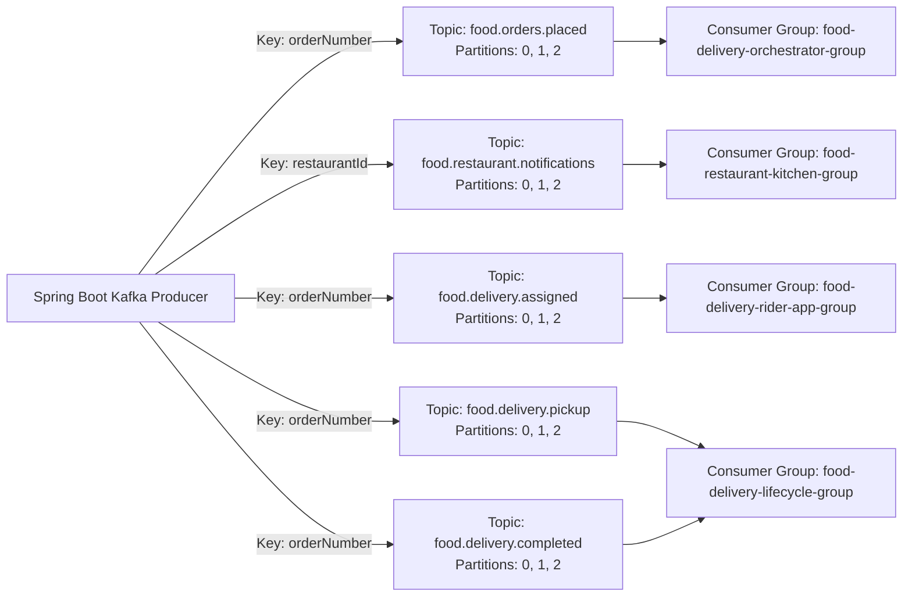

# 06 - Event-Driven Kafka Specifications

## 1. Kafka Cluster & Broker Topology

* **Kafka Mode**: KRaft Mode (Apache Kafka 3.7 - No Zookeeper dependency)
* **Default Port Mapping**:
  - `9092`: Internal Docker network listener (`PLAINTEXT://kafka:9092`)
  - `9094`: Host machine external listener (`EXTERNAL://localhost:9094`)
* **Default Partitions per Topic**: 3 partitions (enables horizontal scale across multiple consumer pods)
* **Replication Factor**: 1 (Single broker development/demo setup; production clusters set to 3 with `min.insync.replicas=2`)

---

## 2. Kafka Topics & Partitioning Strategy



### Partitioning Key Rule:
* **All Order Lifecycle Topics (`food.orders.placed`, `food.delivery.assigned`, `food.delivery.pickup`, `food.delivery.completed`)**:
  - **Key**: `orderNumber` (e.g. `ORD-1763105000000-482`)
  - **Guarantee**: Guarantees that all events for a given order land on the exact same Kafka partition, ensuring strict in-order processing by single-threaded consumer assignment.
* **Restaurant Notification Topic (`food.restaurant.notifications`)**:
  - **Key**: `String.valueOf(restaurantId)`
  - **Guarantee**: Guarantees all kitchen tickets for a specific restaurant arrive on the same partition, preserving store-level FIFO queue order.

---

## 3. Event Schemas & Contracts

### 3.1 Topic: `food.orders.placed`
* **Trigger**: Published when customer successfully places an order.
* **Payload Structure (`OrderPlacedEvent`)**:
```json
{
  "orderId": 101,
  "orderNumber": "ORD-1763105000000-482",
  "restaurantId": 1,
  "restaurantName": "Spice Symphony Gourmet",
  "customerName": "Rahul Verma",
  "customerPhone": "+91-9876540001",
  "customerAddress": "Apartment 402, Lotus Towers, Sector 18",
  "distanceKm": 3.0,
  "queuePosition": 1,
  "estimatedPrepTimeMinutes": 18,
  "estimatedTravelTimeMinutes": 13,
  "estimatedTotalTimeMinutes": 31,
  "totalAmount": 40.48,
  "items": [
    {
      "menuItemId": 1,
      "itemName": "Butter Chicken Royale",
      "quantity": 2,
      "unitPrice": 14.99,
      "subtotal": 29.98
    },
    {
      "menuItemId": 5,
      "itemName": "Garlic Butter Naan",
      "quantity": 3,
      "unitPrice": 3.50,
      "subtotal": 10.50
    }
  ],
  "placedAt": "2026-11-14T08:15:00.120Z"
}
```

---

### 3.2 Topic: `food.restaurant.notifications`
* **Trigger**: Published by orchestrator consumer to alert the restaurant chef.
* **Payload Structure (`RestaurantNotificationEvent`)**:
```json
{
  "restaurantId": 1,
  "restaurantName": "Spice Symphony Gourmet",
  "orderId": 101,
  "orderNumber": "ORD-1763105000000-482",
  "queuePosition": 1,
  "estimatedPrepTimeMinutes": 18,
  "itemSummary": ["2x Butter Chicken Royale", "3x Garlic Butter Naan"],
  "specialInstructions": "Extra spicy, please do not ring the doorbell",
  "notifiedAt": "2026-11-14T08:15:01.200Z"
}
```

---

### 3.3 Topic: `food.delivery.assigned`
* **Trigger**: Published after the dispatch consumer matches an available agent and generates the Pickup OTP.
* **Payload Structure (`DeliveryAssignedEvent`)**:
```json
{
  "orderId": 101,
  "orderNumber": "ORD-1763105000000-482",
  "deliveryAgentId": 1,
  "deliveryAgentName": "Aarav Sharma",
  "deliveryAgentPhone": "+91-9800000001",
  "vehicleType": "Electric Scooter",
  "restaurantId": 1,
  "restaurantName": "Spice Symphony Gourmet",
  "restaurantAddress": "124 Heritage Boulevard, Sector 14",
  "customerName": "Rahul Verma",
  "customerAddress": "Apartment 402, Lotus Towers, Sector 18",
  "distanceKm": 3.0,
  "estimatedTravelTimeMinutes": 13,
  "estimatedPickupMinutes": 18,
  "pickupOtp": "684920",
  "assignedAt": "2026-11-14T08:15:01.450Z"
}
```

---

### 3.4 Topic: `food.delivery.pickup`
* **Trigger**: Published when the restaurant confirms food handover with valid Pickup OTP.
* **Payload Structure (`DeliveryPickupEvent`)**:
```json
{
  "orderId": 101,
  "orderNumber": "ORD-1763105000000-482",
  "deliveryAgentId": 1,
  "deliveryAgentName": "Aarav Sharma",
  "customerPhone": "+91-9876540001",
  "customerAddress": "Apartment 402, Lotus Towers, Sector 18",
  "distanceKm": 3.0,
  "deliveryOtp": "512394",
  "pickedUpAt": "2026-11-14T08:20:00.000Z"
}
```

---

### 3.5 Topic: `food.delivery.completed`
* **Trigger**: Published when the rider confirms doorstep delivery with valid customer Delivery OTP.
* **Payload Structure (`DeliveryCompletedEvent`)**:
```json
{
  "orderId": 101,
  "orderNumber": "ORD-1763105000000-482",
  "deliveryAgentId": 1,
  "deliveryAgentName": "Aarav Sharma",
  "distanceKm": 3.0,
  "deliveredAt": "2026-11-14T08:33:00.000Z"
}
```

---

## 4. Consumer Group Isolation & Scalability

| Consumer Group | Listened Topic(s) | Function & Workload | Scalability Mode |
| :--- | :--- | :--- | :--- |
| `food-delivery-orchestrator-group` | `food.orders.placed` | Dispatches store notifications, searches nearest agent, creates Redis Pickup OTP, records delivery assignment | Up to 3 consumer instances (1 per partition) |
| `food-restaurant-kitchen-group` | `food.restaurant.notifications` | Updates store KOT terminal, marks cooking status in database | Up to 3 consumer instances |
| `food-delivery-rider-app-group` | `food.delivery.assigned` | Pushes push notifications to rider smartphone, updates rider location log | Independent subscriber |
| `food-delivery-lifecycle-group` | `food.delivery.pickup`, `food.delivery.completed` | Emits customer push notifications, updates order tracking analytics | Shared consumer group across pickup and completion |

---

## 5. Resilience & Idempotency Patterns

1. **Producer Idempotence**:
   - `enable.idempotence: true` prevents broker duplicate writes caused by producer retries during transient network acks timeouts.
   - `acks: all` ensures full in-sync replication acknowledgment before returning success.
2. **Consumer Idempotency**:
   - Consumers check for duplicate event IDs in a `processed_events` PostgreSQL table in the same transaction to guarantee exactly-once processing semantics at the business layer.
3. **Poison-Pill & DLT Recovery**:
   - `DefaultErrorHandler` configured with retry backoff. Exhausted records route to dedicated `.DLT` topics (e.g. `food.orders.placed.DLT`) for manual inspection or dead-letter replay.
