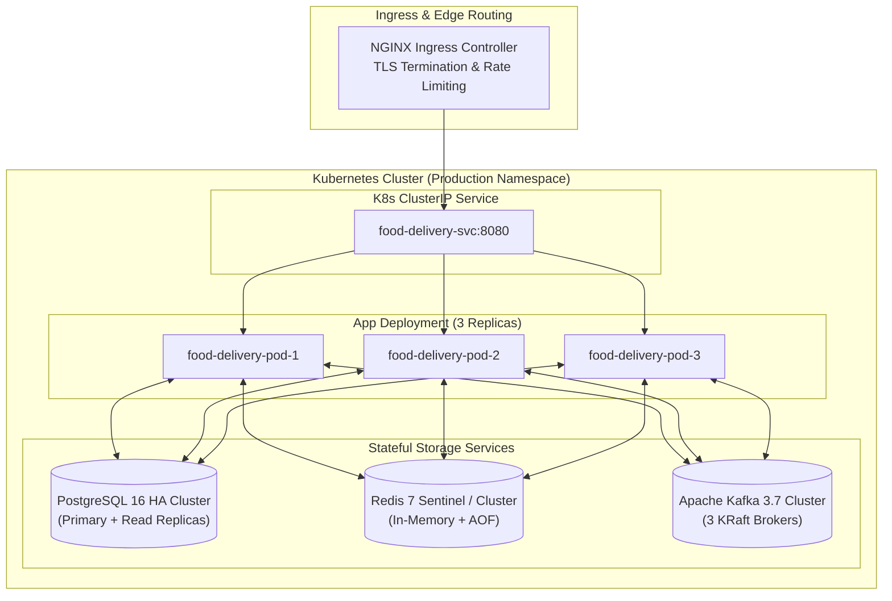

# 07 - Security Architecture & Production Deployment Guide

## 1. Security Architecture & Threat Defense

### 1.1 Two-Step OTP Hardening Matrix

| Security Layer | Standard Vulnerability | Hardened Defense Implementation |
| :--- | :--- | :--- |
| **Generation** | Predictable RNG | `java.security.SecureRandom` generates cryptographically secure 6-digit numeric integers ($100,000 - 999,999$). |
| **Transmission** | Plaintext eavesdropping | Enforce TLS 1.3 on all client-to-gateway HTTPS connections. Mask OTP values in stdout logs (`[REDACTED]`). |
| **In-Memory TTL** | Stale token replay | Native Redis key expiration: **15 mins for Pickup OTP**, **30 mins for Delivery OTP**. |
| **Brute-Force Attack** | Rapid dictionary scan | Counter `otp:attempts:{orderId}:{type}` in Redis. Limit to **3 invalid attempts**. On 4th attempt, delete OTP, lock order, and trigger alert. |
| **Database Audit Storage**| Plaintext database leak | Store only a salted one-way hash (`SHA-256(otp + salt)`) in PostgreSQL `delivery_assignments`. Never persist raw plaintext OTPs to disk. |
| **One-Time Consumption**| Race condition replay | Atomic `GETDEL` (Redis 6.2+) or Lua script execution during verification to guarantee one-time verification across threads. |

---

## 2. Environment Secrets & Configuration Hardening

### 2.1 Production Property Rules
* ❌ **Never** check default fallback passwords into `application.yml` (e.g. `password: ${DB_PASSWORD:fooddelivery_password}`).
* ✅ **Always** require strict environment injection without default secrets:
```yaml
spring:
  datasource:
    url: jdbc:postgresql://${DB_HOST}:${DB_PORT}/${DB_NAME}
    username: ${DB_USER}
    password: ${DB_PASSWORD}
  data:
    redis:
      host: ${REDIS_HOST}
      port: ${REDIS_PORT}
      password: ${REDIS_PASSWORD}
      ssl:
        enabled: ${REDIS_SSL_ENABLED:true}
```

---

## 3. Container & Kubernetes Deployment Blueprint



### 3.1 Kubernetes Deployment YAML Manifest
```yaml
apiVersion: apps/v1
kind: Deployment
metadata:
  name: food-delivery-app
  namespace: fooddelivery-prod
  labels:
    app: food-delivery
spec:
  replicas: 3
  selector:
    matchLabels:
      app: food-delivery
  template:
    metadata:
      labels:
        app: food-delivery
    spec:
      containers:
        - name: app
          image: fooddelivery/backend:1.0.0
          ports:
            - containerPort: 8080
          resources:
            requests:
              cpu: "500m"
              memory: "1Gi"
            limits:
              cpu: "2000m"
              memory: "2Gi"
          envFrom:
            - secretRef:
                name: fooddelivery-secrets
            - configMapRef:
                name: fooddelivery-config
          livenessProbe:
            httpGet:
              path: /actuator/health/liveness
              port: 8080
            initialDelaySeconds: 30
            periodSeconds: 10
          readinessProbe:
            httpGet:
              path: /actuator/health/readiness
              port: 8080
            initialDelaySeconds: 15
            periodSeconds: 5
          lifecycle:
            preStop:
              exec:
                command: ["/bin/sh", "-c", "sleep 15"]
```

---

## 4. Observability & Health Monitoring

### 4.1 Actuator Probe Configuration (`application.yml`)
```yaml
server:
  shutdown: graceful

spring:
  lifecycle:
    timeout-per-shutdown-phase: 30s

management:
  endpoints:
    web:
      exposure:
        include: health,info,metrics,prometheus
  endpoint:
    health:
      show-details: when_authorized
      probes:
        enabled: true
  health:
    livenessstate:
      enabled: true
    readinessstate:
      enabled: true
```

### 4.2 Critical Production Alert Rules

| Alert Rule | Metric / PromQL Query | Warning Threshold | Critical Action |
| :--- | :--- | :---: | :--- |
| **Kafka Consumer Lag** | `kafka_consumergroup_lag{topic="food.orders.placed"} > 100` | 2 minutes | Auto-scale consumer replicas; page on-call engineer |
| **OTP Verification Failures** | `rate(food_delivery_otp_failures_total[5m]) > 10` | 1 minute | Potential brute-force attack; IP rate-limit triggered |
| **Agent Fleet Exhaustion** | `delivery_agents_available_count == 0` | 5 minutes | Surge pricing alert / broadcast rider incentive |
| **Database Pool Saturation** | `hikaricp_connections_active / hikaricp_connections_max > 0.85` | 3 minutes | Scale connection pool or optimize slow transactions |
